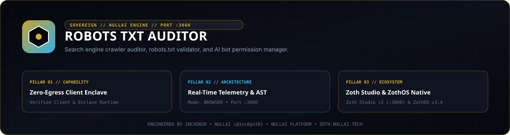

<div align="center">
  
</div>

<br />

<div align="center">
  <a href="https://zoth.nullai.tech/tools/robots-txt-auditor"></a>
  <a href="http://127.0.0.1:8086"></a>
  <a href="https://nullai.tech"></a>
  <a href="https://buy.stripe.com/3cIfZg27PdKo2D64Ocfw40X"></a>
</div>

# ⚡ Robots.txt & AEO Auditor

> **Robots.txt & AEO Auditor — 100% in-browser RFC 9309 robots.txt parser, AI crawler simulator, drift detection, and AEO optimization.**

---

## 🏛️ Architectural Overview

**Robots.txt & AEO Auditor** is an official sovereign tool in the **[Zoth Studio v2](https://zoth.nullai.tech)** (72-Tool Matrix) and **[ZothOS Linux 3.3](https://zothos.nullai.tech)** ecosystem, engineered by **1nc0gn30 • NullAI ([@1nc0gn30](https://github.com/1nc0gn30))**.

| Property | Specification |
| :--- | :--- |
| **Tool ID** | `robots-txt-auditor` |
| **Category** | `Growth & SEO` |
| **Loopback Daemon Port** | `http://127.0.0.1:8086` |
| **Execution Mode** | `browser` + Python Server Daemon |
| **Zoth Studio Route** | [`http://127.0.0.1:3000/tools/robots-txt-auditor`](http://127.0.0.1:3000/tools/robots-txt-auditor) |
| **License** | **100% Free & Open Access (Zero Paywalls)** |

---

## 💎 What It Does & How It Works

- **RFC 9309 AST Compliance**: Full client-side and server-side parsing conforming strictly to modern robots.txt syntax.
- **Frontier AI & Search Engine Simulator**: Tests path permissions across Googlebot, GPTBot, ClaudeBot, PerplexityBot, and Applebot simultaneously.
- **AEO Readiness Scoring**: Evaluates crawlability, sitemap inclusion, and explicit bot directives to maximize citation in AI Answer Engines.
- **Drift Shield**: Detects accidental disallows, conflicting wildcard matching, and syntax errors in real-time.
- **100% Zero-Egress Local Enclave Execution**: Runs completely on `127.0.0.1:8086` with zero third-party telemetry.

---

## 🛠️ ZothOS CLI & Daemon Commands

The CLI is pre-installed in `/usr/local/bin/robots-txt-auditor` (aliased as `robots-txt`):

```bash
# Check daemon health & ZothOS integration status
robots-txt --status

# Audit a local robots.txt file or raw string
robots-txt --audit /path/to/robots.txt

# Deterministic JSON telemetry output
robots-txt --json

# Start the standalone server daemon on port 8086
robots-txt --serve
# Or directly via Python:
python3 /home/zoth/NullAITech/robots-txt-auditor/server.py --port 8086
```

---

## ☕ Support 1nc0gn30 • NullAI (Zero Paywalls)

All tools across the Zoth Studio ecosystem are 100% free, unlocked, and open-source by default. If this utility provides value to your workflow, support development via:

- **Stripe "Buy Us a Coffee"**: [https://buy.stripe.com/3cIfZg27PdKo2D64Ocfw40X](https://buy.stripe.com/3cIfZg27PdKo2D64Ocfw40X)
- **Solana Tip Address**: `GG2eQbVh8ut1BK6j1A2tz7pSySdLpD38BgyEhGcxdXoK`

---

<div align="center">
  <sub>Engineered by <b>1nc0gn30 • NullAI</b> (<a href="https://github.com/1nc0gn30">@1nc0gn30</a>) &bull; <a href="https://nullai.tech">NullAI Platform</a> &bull; <a href="https://zoth.nullai.tech">Zoth Studio v2</a></sub>
</div>
